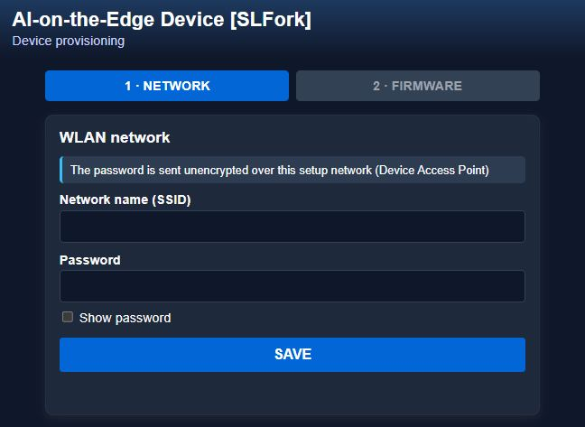
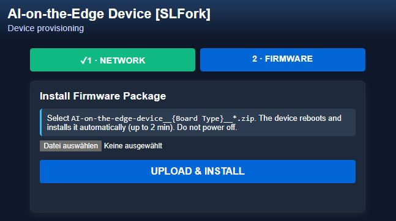
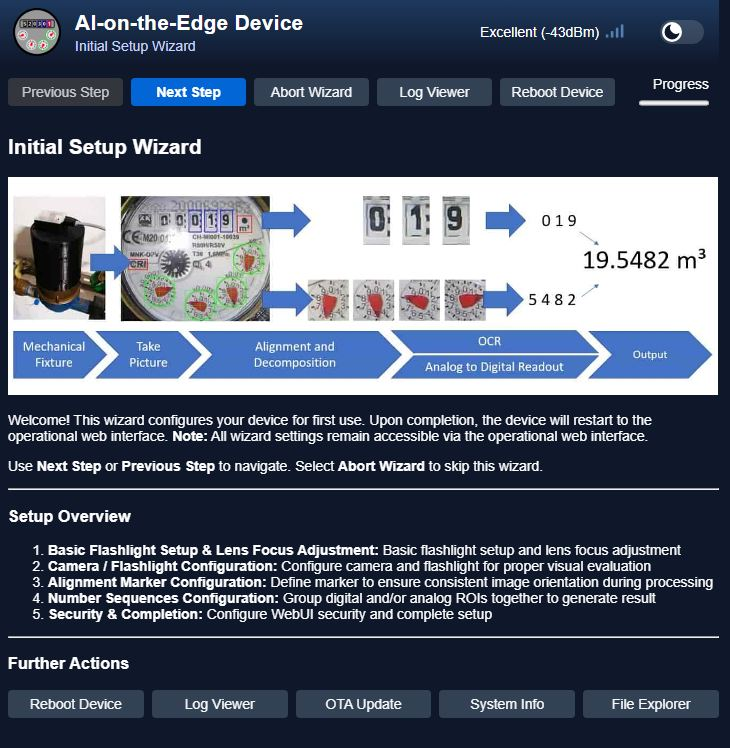

## SD Card Provisioning

**Precondition**: Insert a **formatted and empty SD card** into the device, and power it on with the 
firmware already flashed to the MCU.

---

### Option 1 (Preferred): Via Web Installer

Follow the instructions in the [Web Installer guide](WebInstaller.md), starting from **Step 5**.

---

### Option 2: Via Access Point  

1. Connect to the device’s WLAN access point:  
   **SSID:** `AI-on-the-Edge Device`
   - Channel: 11
   - Open Network (no password)
   - DHCP server enabled

2. Open your browser and go to [http://192.168.4.1](http://192.168.4.1), then follow the steps below:

   **2.1.** Configure WLAN Network

   

   **2.2.** Install Firmware / SD Card Content
   - In the device provisioning interface, select the **firmware ZIP file** (to be downloaded from [GitHub Releases](https://github.com/Slider0007/AI-on-the-edge-device/releases/latest))
   - Click **"UPLOAD & INSTALL"** to begin uploading the file
   - The device will reboot and install the package (MCU + SD-card)
   - Optional: You can monitor installation progress or view logs in the Web Installer using **"Logs & Console"**
   

3. After installation is completed, access the device using one of the following
   - Webinstaller: `VISIT DEVICE` button
   - Hostname: [http://watermeter](http://watermeter)
   - mDNS: [http://watermeter.local](http://watermeter.local)
   - IP-Address: Or check your router logs to find the assigned IP address

4. You will be guided through the **Initial Setup Wizard**:  
   
